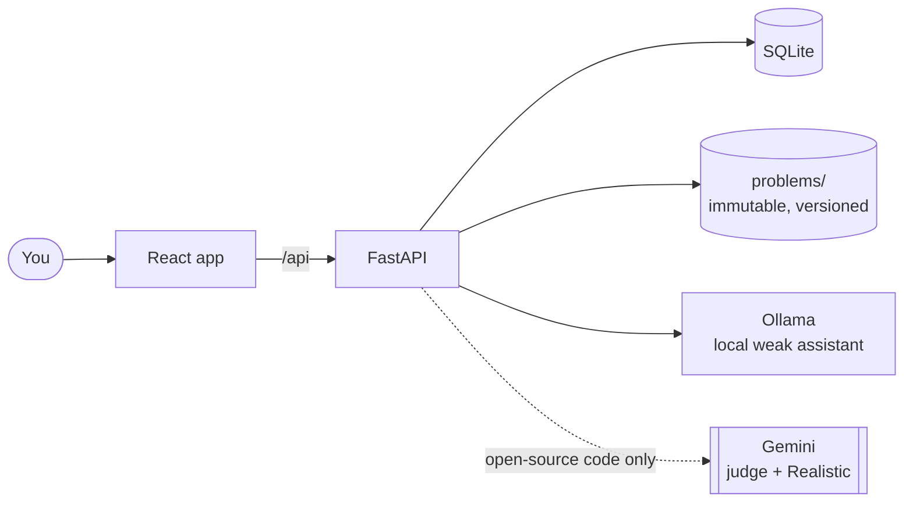

# Scholia

[](https://github.com/debarshi29/scholia/actions/workflows/ci.yml)


**Practise the interview round where you get an unfamiliar codebase, an AI assistant and an hour.**

Scholia is a single-user, local-first platform for AI-assisted code-comprehension practice. You are handed a real file you have not seen, with a bug a project's maintainers once fixed. You read it, ask a *deliberately weak* assistant about the lines you select, flag the bug and explain it (or fix it), and submit. Then you get a graded debrief against an answer key built from the real upstream fix.

The skill being trained is **reading code and verifying what an AI tells you**, not typing speed.

<table>
<tr>
<td></td>
<td></td>
</tr>
<tr>
<td align="center"><sub>Library: pick a problem, grouped by bug category (light)</sub></td>
<td align="center"><sub>Session: code, assistant and report (dark)</sub></td>
</tr>
</table>

## Highlights

- **Real bugs.** Problems come from SWE-bench Lite and BugsInPy fixes, plus deterministic bugs planted in algorithm files that real tests then catch. No model writes the bugs.
- **A weak assistant on purpose.** Constrained mode runs a small local model (Qwen2.5-Coder via Ollama) that sees only the lines you select, with a token cap and a question budget. Realistic mode gives it the whole file via Gemini.
- **Deterministic grading.** Whether you found the bug is decided by line overlap, never by a model. A rubric-driven Gemini judge scores only *how well* you explained and fixed it, and audits whether the assistant misled you.
- **Fix it, don't just find it.** Switch the editor to Fix mode; your edit is checked for location and syntax, judged against the reference fix, and, for algorithm problems, run against the file's own doctests.
- **Learns your weak spots.** Miss rate per bug category weights the next problem. Local profiles keep several people's progress apart.
- **Local-first and private.** Your sessions, assistant logs and history stay on your machine. Only open-source problem code ever goes to Gemini, and only for permissive licences.
- **Light and dark themes**, keyboard-friendly, accessible controls.

## How a session works

1. **Pick** a problem, or let the picker choose by your weak spots.
2. **Read.** Click two line numbers to select a range; the context bar shows its token cost.
3. **Ask** the assistant. Refusals (no selection, over the cap, out of questions) cost nothing.
4. **Flag** the lines you think are wrong and write why, and what the fix is. Optionally edit the code in Fix mode.
5. **Submit.** The server owns the clock; a late submit is accepted and marked overtime.
6. **Debrief.** Your findings against the key, judge scores, an audit of the assistant's claims, your diff, and the upstream fix.

## Quick start

Full instructions, prerequisites and troubleshooting: **[docs/guides/setup.md](docs/guides/setup.md)**.

```bash
git clone https://github.com/debarshi29/scholia.git && cd scholia
uv sync --locked                      # Python deps (Python 3.12)
(cd web && pnpm install --frozen-lockfile)
ollama pull qwen2.5-coder:3b          # the local assistant
cp .env.example .env                  # set GEMINI_API_KEY and GEMINI_MODEL

# build some problems (a free Gemini key is enough)
uv run python -m corpus.build --tier 0 --source swebench --limit 15
uv run python -m corpus.build --tier 0 --source bugsinpy --limit 15

# run: two terminals
uv run python -m uvicorn api.main:app --port 8000
(cd web && pnpm dev)                  # http://localhost:5173
```

Data-structure and algorithm problems (planted bugs) are built with an explicit command because it runs a repository's doctests locally; see the [corpus guide](docs/guides/corpus.md#planted-bugs-in-detail).

## Architecture at a glance



Ten invariants hold the design together; the most important are: the answer key never reaches the client before submit; the assistant proxy is the only path to a model; matching is deterministic and the LLM only scores; problems are immutable; only open-source code goes to Gemini. They are listed in [`CLAUDE.md`](CLAUDE.md#5-core-invariants-never-break-these), and each has a test.

## Documentation

| Document | What it covers |
|---|---|
| [docs/guides/setup.md](docs/guides/setup.md) | Install, configure, build problems, run, first session, troubleshooting |
| [docs/architecture/hld.md](docs/architecture/hld.md) | High-level design: context, containers, flows, trust boundaries, deployment, risks |
| [docs/architecture/lld.md](docs/architecture/lld.md) | Low-level design: modules, data model, API, algorithms, corpus pipeline, frontend |
| [docs/architecture/decisions.md](docs/architecture/decisions.md) | Decision log with alternatives and consequences |
| [docs/guides/corpus.md](docs/guides/corpus.md) | How problems are made and how to add a source |
| [docs/guides/operations.md](docs/guides/operations.md) | Configuration reference, logs, backups, security notes |
| [docs/interview/questions.md](docs/interview/questions.md) | Interview questions about this project, with answer outlines |
| [CONTRIBUTING.md](CONTRIBUTING.md) | Workflow, conventions, quality gates |
| [SECURITY.md](SECURITY.md) | Threat model summary and how to report issues |
| [`CLAUDE.md`](CLAUDE.md) | The living specification: scope, invariants, contracts, owner decisions |

## Tech stack

| Layer | Choice |
|---|---|
| Backend | Python 3.12, FastAPI, Pydantic v2, SQLModel on async SQLAlchemy and aiosqlite |
| AI | Ollama (local Qwen2.5-Coder), Gemini via `google-genai`, Hugging Face tokenizer for exact token counts |
| Corpus | `httpx`, GitPython, `ast`-based sanitising and mutation |
| Frontend | React 19, Vite, TypeScript, Tailwind CSS 3, TanStack Query, Zustand, Monaco (bundled locally) |
| Tooling | uv, pnpm, ruff, mypy (strict on `schema/` and `api/grader/`), pytest, ESLint, GitHub Actions |

## Repository layout

```
schema/    shared types: the single source of truth
corpus/    offline pipeline that builds problems (sources, filters, sanitise, classify, publish)
api/       FastAPI app: sessions, assistant proxy, grader, debrief, profiles
web/       React app
tests/     pytest suite (about 360 tests; every invariant has one)
docs/      architecture, guides, interview questions, screenshots
scripts/   py.cmd: Windows helper when Smart App Control blocks .venv launchers
```

## Development

```bash
uv run ruff check . && uv run ruff format --check .
uv run python -m mypy schema api/grader
uv run pytest -q                       # offline; add -m live for real model calls
cd web && pnpm typecheck && pnpm lint && pnpm build
cd web && pnpm gen:api                 # after any API change
```

See [CONTRIBUTING.md](CONTRIBUTING.md). On Windows machines with Smart App Control, see [Windows notes](docs/guides/setup.md#10-troubleshooting).

## Dogfooding and judge agreement

Scholia measures whether its judge agrees with you.

```bash
uv run python -m api.grader.agreement export data/agreement.csv   # one row per matched finding
# fill in hand_mechanism (0-2) and hand_fix (0-2), then:
uv run python -m api.grader.agreement check data/agreement.csv
```

`check` prints how often the judge equals your scores and lists every disagreement. If agreement is poor, change the rubric in `api/grader/prompts/` (bump its version header) and use **Grade again** on the debrief.

## Status

| Milestone | State |
|---|---|
| M0 skeleton, schema, config, DB, tooling | done |
| M1 Tier 0 corpus importer (SWE-bench Lite, BugsInPy) | done |
| M2 Session API, Library and Session pages | done |
| M3 Assistant proxy, Ollama and Gemini backends | done |
| M4 Grader, tracker, Debrief | done |
| Additions requested by the owner: category grouping, topics, fix mode, planted-bug (DSA/CP) source, local profiles, light and dark themes | done |
| M5 dogfood gate (5-10 real sessions, hand-graded judge agreement) | yours to run |
| M6 and later: sandboxed test execution, GitHub miner, more languages | not started |

## Limitations

- **No authentication.** It is a local tool bound to localhost. Profiles separate progress; they do not protect it. Do not expose it to a network.
- **Python only**, one bug per problem, file sizes 150-500 lines (60-500 for algorithm files).
- **Fixes are judged, and only algorithm problems are executed.** A fix to a planted-bug (data-structure and algorithm) problem is also run against that file's doctests. Other problems have no test runner yet.
- Some SWE-bench instances are really missing features rather than spottable bugs; note their ids while practising.
- Bug categories are assigned by an LLM and most Tier 0 problems classify as `logic`, so weak-spot bars start lopsided.

## Licence

Scholia's own source code is released under the [MIT licence](LICENSE). Problem code is derived from open-source projects and stays under each project's own licence, recorded in every problem's `meta.json`.
