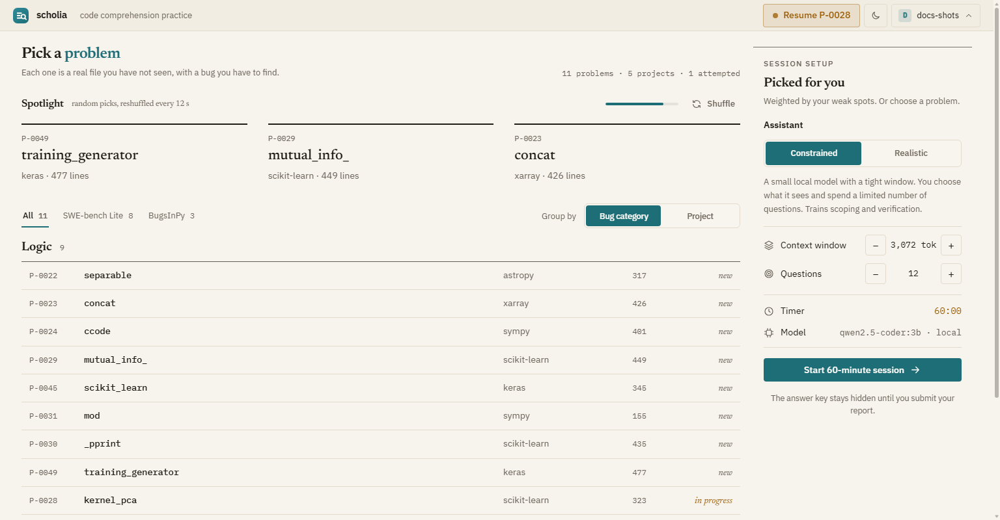
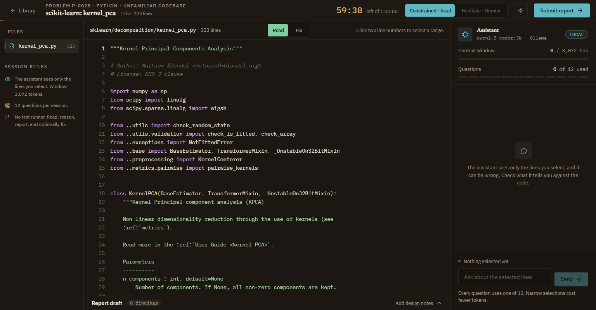
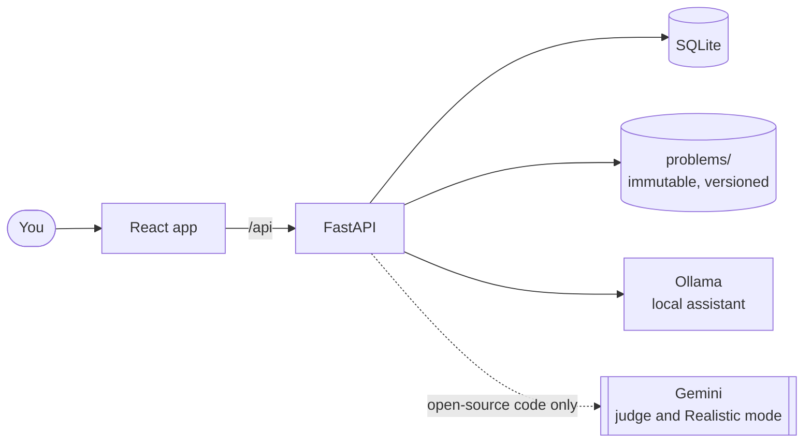

# Scholia

[](https://github.com/debarshi29/scholia/actions/workflows/ci.yml)


**Practice the interview round where you get an unfamiliar codebase, an AI assistant and an hour.**

Scholia is a local-first practice platform for AI-assisted code-comprehension interviews. You are handed a real source file you have not seen, containing a bug that a project's maintainers once fixed. You read it, ask a deliberately limited assistant about the lines you select, flag the bug and explain it (or fix it), and submit. You then get a graded debrief against an answer key built from the real fix.

The skill it trains is **reading unfamiliar code and verifying what an AI tells you**, not typing speed.

<table>
<tr>
<td></td>
<td></td>
</tr>
<tr>
<td align="center"><sub>Library: pick a problem, grouped by bug category</sub></td>
<td align="center"><sub>Session: code, assistant and report</sub></td>
</tr>
</table>

## Features

- **Real bugs.** Problems come from SWE-bench Lite and BugsInPy fixes in projects such as scikit-learn, Keras, sympy and pandas, plus data-structure and algorithm problems with bugs planted deterministically and caught by real tests.
- **A deliberately limited assistant.** In Constrained mode a small local model (Qwen2.5-Coder through Ollama) sees only the lines you select, within a token cap and a question budget. Realistic mode gives a stronger model (Gemini) the whole file.
- **Objective grading.** Whether you found the bug is decided by line overlap, never by a model. A rubric-driven judge scores how well you explained and fixed it, and audits whether the assistant misled you.
- **Fix it, not just find it.** Switch the editor to Fix mode. Your change is checked for location and syntax, judged against the reference fix, and, for algorithm problems, run against the file's own tests.
- **Targets your weak spots.** Miss rate per bug category decides which problem you get next. Local profiles keep several people's progress separate.
- **Private by default.** Sessions, assistant logs and history stay on your machine. Only open-source problem code is ever sent to a cloud model, and only for permissive licences.
- **Light and dark themes**, keyboard-friendly and accessible.

## How a session works

1. **Pick** a problem, or let Scholia choose one based on your weak spots.
2. **Read** the code. Click two line numbers to select a range; the context bar shows its cost.
3. **Ask** the assistant about the selection. Refused questions cost nothing.
4. **Flag** the lines you think are wrong, explain why, and say how to fix it. Optionally edit the code in Fix mode.
5. **Submit.** The server keeps the clock; a late submission is accepted and marked overtime.
6. **Debrief.** See your findings against the answer key, the judge's scores, an audit of what the assistant told you, your diff and the upstream fix.

## Quick start

You need Python 3.12, Node 24, [uv](https://docs.astral.sh/uv/), [pnpm](https://pnpm.io), [Ollama](https://ollama.com) and a free [Gemini API key](https://aistudio.google.com/apikey). Full instructions and troubleshooting are in the **[setup guide](docs/guides/setup.md)**.

```bash
git clone https://github.com/debarshi29/scholia.git && cd scholia
uv sync --locked
(cd web && pnpm install --frozen-lockfile)
ollama pull qwen2.5-coder:3b          # the local assistant
cp .env.example .env                  # then set GEMINI_API_KEY and GEMINI_MODEL

# build a problem library
uv run python -m corpus.build --tier 0 --source swebench --limit 15
uv run python -m corpus.build --tier 0 --source bugsinpy --limit 15

# run (two terminals)
uv run python -m uvicorn api.main:app --port 8000
(cd web && pnpm dev)                  # open http://localhost:5173
```

Prefer containers? `docker compose up --build -d` runs the API, the web app and Ollama together; see [Run with Docker](docs/guides/setup.md#11-run-with-docker-alternative-to-steps-3-to-7). Data-structure and algorithm problems are built with a separate command; see the [corpus guide](docs/guides/corpus.md#planted-bugs-in-detail).

## Architecture



A few principles shape the design: the answer key is never sent to the browser before you submit; every assistant call goes through one proxy that enforces the limits; matching is deterministic and the model only scores; published problems never change; and only open-source code is sent to a cloud model. Each is covered by tests. The [high-level design](docs/architecture/hld.md) and [low-level design](docs/architecture/lld.md) describe them in detail, with diagrams.

## Documentation

| Document | Contents |
|---|---|
| [Setup guide](docs/guides/setup.md) | Install, configure, build problems, run locally or with Docker, first session, troubleshooting |
| [High-level design](docs/architecture/hld.md) | Context, components, flows, trust boundaries, deployment |
| [Low-level design](docs/architecture/lld.md) | Modules, data model, API, algorithms, corpus pipeline, frontend |
| [Decision log](docs/architecture/decisions.md) | Key decisions with alternatives and consequences |
| [Corpus guide](docs/guides/corpus.md) | How problems are made, and how to add a source |
| [Operations guide](docs/guides/operations.md) | Configuration reference, logs, backups, security notes |
| [Contributing](CONTRIBUTING.md) | Workflow, conventions and quality checks |
| [Security](SECURITY.md) | Security model and how to report an issue |

## Technology

| Layer | Choice |
|---|---|
| Backend | Python 3.12, FastAPI, Pydantic v2, SQLModel on async SQLAlchemy |
| AI | Ollama (local Qwen2.5-Coder), Gemini, Hugging Face tokenizer for exact token counts |
| Frontend | React 19, Vite, TypeScript, Tailwind CSS, TanStack Query, Zustand, Monaco |
| Quality | pytest with an 85% coverage floor, ruff, mypy, ESLint, GitHub Actions, weekly dependency audits |
| Packaging | uv, pnpm, Docker and Docker Compose |

## Scope and security

Scholia is built for one person practising on their own machine.

- It has **no authentication** and listens on localhost. Profiles keep progress separate but do not protect it, so do not expose it to a network.
- Problems are Python source files of 60 to 500 lines, each with one bug.
- Fixes are judged by a model; fixes to algorithm problems are also run against that file's tests.

To report a vulnerability, see [SECURITY.md](SECURITY.md).

## Development

```bash
uv run ruff check . && uv run ruff format --check .
uv run python -m mypy schema api/grader
uv run pytest -q --cov
cd web && pnpm typecheck && pnpm lint && pnpm build
```

See [CONTRIBUTING.md](CONTRIBUTING.md) for the full workflow.

## Licence

Scholia's source code is released under the [MIT licence](LICENSE). Problem code is derived from open-source projects and stays under each project's own licence, recorded in every problem's `meta.json`.
