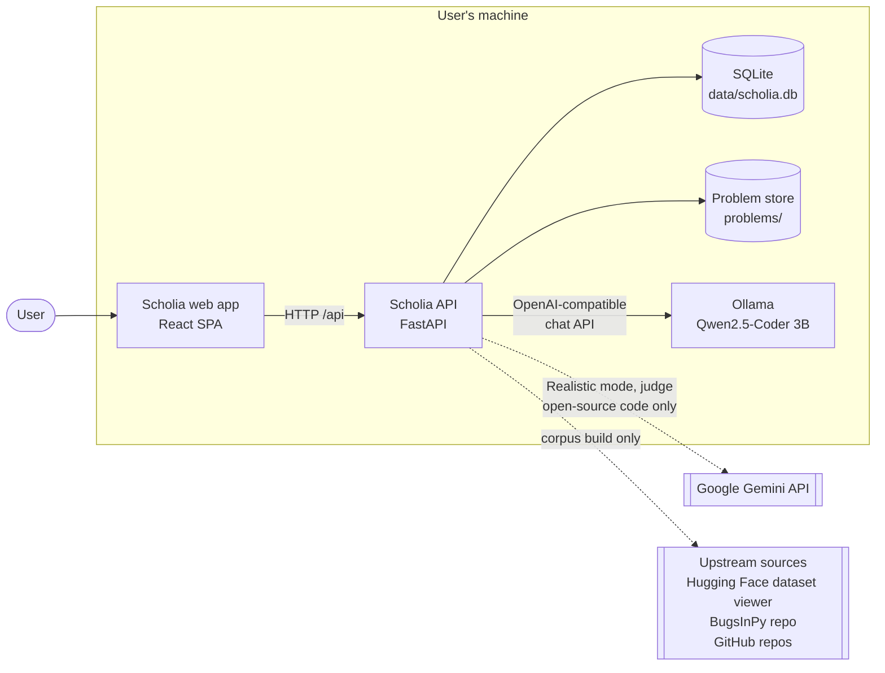
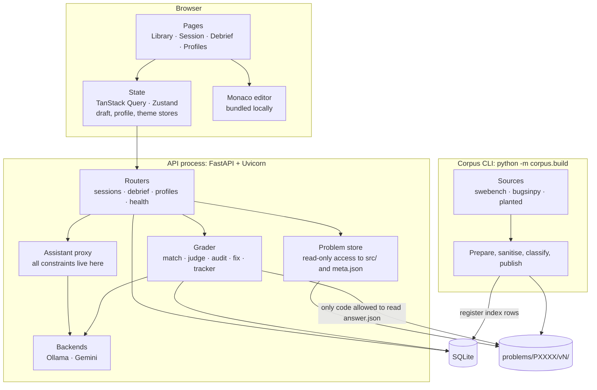
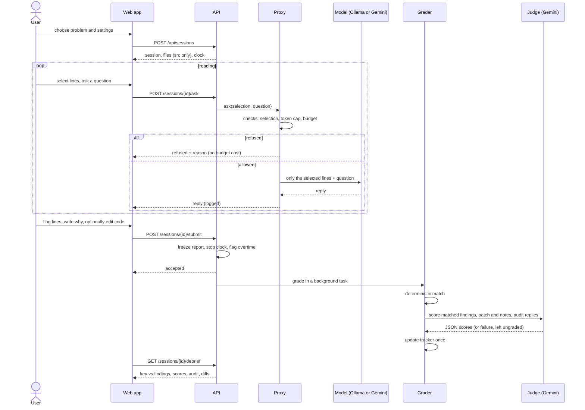
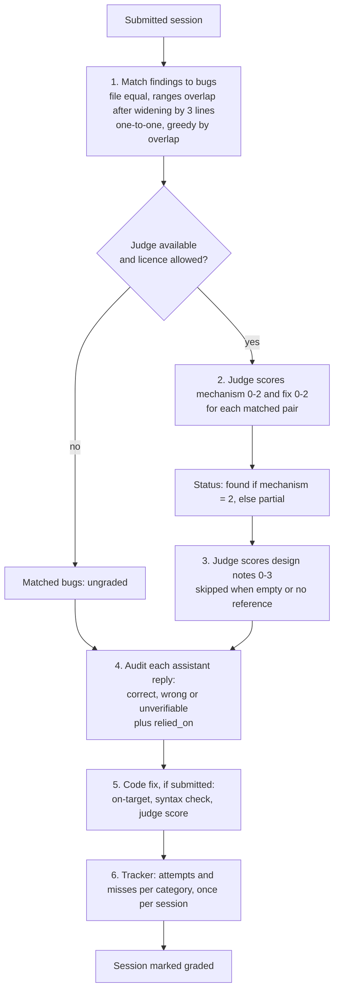
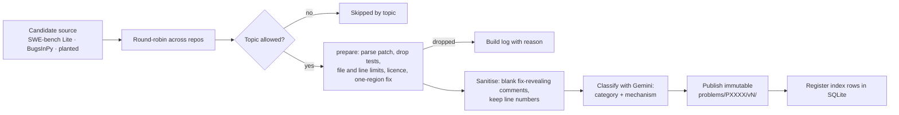
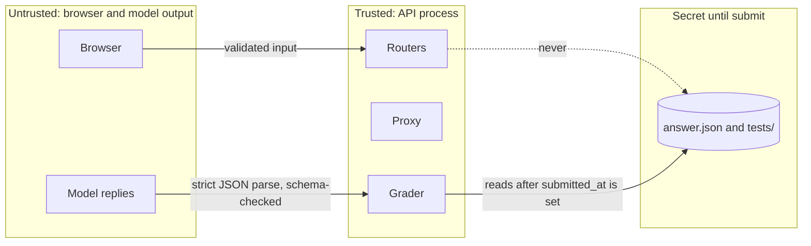
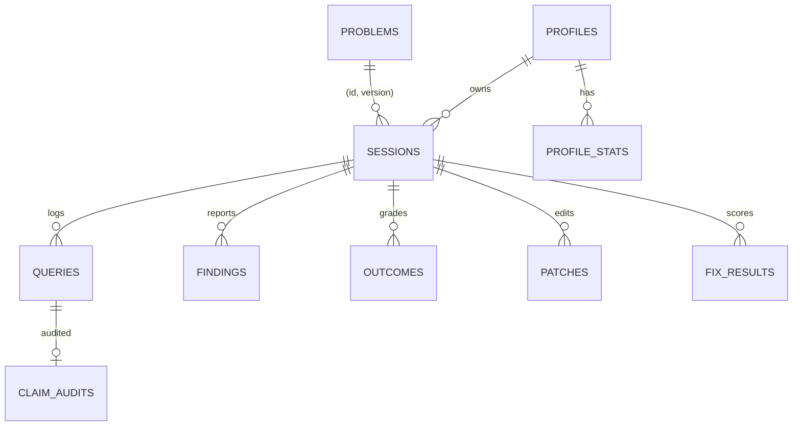
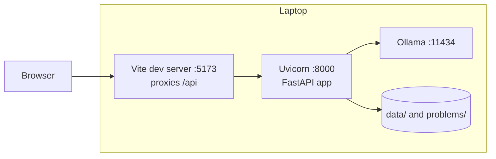

# High-Level Design

Scholia is a **single-user, local-first practice platform for AI-assisted code-comprehension interviews**. This document explains what the system is for, how it is put together, how data and trust flow through it, and why the main choices were made. Module-level detail is in the [Low-Level Design](lld.md); the decision log is in [decisions.md](decisions.md).

## Contents

1. [Purpose and scope](#1-purpose-and-scope)
2. [Quality attributes](#2-quality-attributes)
3. [System context](#3-system-context)
4. [Containers](#4-containers)
5. [Core flows](#5-core-flows)
6. [Trust boundaries and security](#6-trust-boundaries-and-security)
7. [Data stores](#7-data-stores)
8. [Deployment](#8-deployment)
9. [Cross-cutting concerns](#9-cross-cutting-concerns)
10. [Constraints, assumptions and risks](#10-constraints-assumptions-and-risks)
11. [Evolution](#11-evolution)

---

## 1. Purpose and scope

Modern coding interviews increasingly hand the candidate an unfamiliar codebase and an AI assistant. What is being tested is not typing speed. It is whether the candidate can **read code they did not write, find what is wrong, and notice when the assistant is wrong**.

Scholia trains that skill:

| Step | What the user does | What the system does |
|---|---|---|
| Pick | Chooses a problem, or lets the picker choose by weak spots | Weights unattempted problems by the user's miss rate per bug category |
| Read | Opens an unfamiliar 60-500 line file | Serves sanitised source, never the answer |
| Ask | Asks a deliberately weak assistant about selected lines | Enforces a context cap and a question budget; logs every exchange |
| Report | Flags lines as bugs, writes why, optionally edits the code to fix it | Freezes the report; stops the server-side clock |
| Debrief | Reads the graded result | Matches deterministically, scores with a rubric, audits the assistant's claims |

**In scope:** one user (or several local profiles) on one machine; Python source problems; two assistant modes; deterministic grading plus an LLM judge with a fixed rubric; per-category tracking; a React UI.

**Out of scope (by decision):** hosted deployment, authentication, other languages, running candidate code, a Docker verifier, user-generated problems. See [decisions.md](decisions.md) for the reasoning behind each.

## 2. Quality attributes

These drive the design. Where two conflict, the earlier one wins.

| # | Attribute | Meaning here | Main mechanism |
|---|---|---|---|
| 1 | **Answer integrity** | The key is never visible before submit | No endpoint a live session can call returns it; leak test |
| 2 | **Grading determinism** | Whether a finding matched a bug never depends on a model | Pure line-overlap matcher; the LLM only scores |
| 3 | **Training validity** | The assistant must stay weak and bounded | All limits enforced in one proxy; selection-only context |
| 4 | **Privacy** | Code and answers stay on the machine, except open-source problem code | Local Ollama by default; licence allowlist before any Gemini call |
| 5 | **Reproducibility** | A debrief can be re-read months later | Problems are immutable and versioned; sessions pin `(problem, version)` |
| 6 | **Resilience** | A flaky judge never loses a session | Grading always completes; failures become `ungraded` and can be regraded |
| 7 | **Operability** | Easy to run and debug locally | One SQLite file, JSON logs, a build log that explains every dropped candidate |
| 8 | **Cost** | Free tier is enough | Small local model; one judge call per matched finding; capped tokens |

## 3. System context

Only the dashed edges leave the machine, and only for open-source problem code (see [section 6](#6-trust-boundaries-and-security)). With no Gemini key the app still runs: Constrained mode works, and grading degrades to deterministic matching with judge scores left `ungraded`.

## 4. Containers

| Container | Responsibility | Technology |
|---|---|---|
| Web app | Rendering, line selection, report drafting, theming. Holds no secrets and calls no model | React 19, Vite, TypeScript, Tailwind 3, TanStack Query, Zustand, Monaco |
| API | Sessions, the clock, report intake, the assistant proxy, grading, debrief, profiles | FastAPI, Pydantic v2, SQLModel on async SQLAlchemy |
| Assistant proxy | The only path to a model during a session; enforces every limit | `api/proxy.py` |
| Grader | The only code that opens `answer.json` for a session | `api/grader/` |
| Corpus CLI | Turns upstream bug fixes (or planted bugs) into published problems | `corpus/` |
| SQLite | Sessions, queries, findings, outcomes, stats, profiles | One file, `aiosqlite` |
| Problem store | Immutable problem folders: `src/`, `answer.json`, `meta.json`, `tests/` | Plain files |

The **schema package** (`schema/`) is the single source of truth for shared types. The API, the CLI and (through OpenAPI) the web client all derive from it.

## 5. Core flows

### 5.1 A session, end to end

### 5.2 Grading pipeline

Matching is deterministic and runs first. The judge can lower a score; it can never undo a match (invariant 9).

### 5.3 Corpus build

The build is offline-friendly and idempotent: published problems are skipped on re-run, and every candidate ends up either published or in the log with a reason.

## 6. Trust boundaries and security

| Concern | Control |
|---|---|
| **Answer leakage** | `answer.json` and `tests/` are readable only by the grader and the debrief route, and only for sessions with `submitted_at`. `ProblemStore` exposes `src/` and `meta.json` only. A test walks every route of a live session and asserts the key's strings never appear |
| **Prompt hygiene** | The assistant's system prompt never mentions bugs, interviews or that bugs exist. Constrained prompts contain only numbered selected lines and the question, with no file path and no history |
| **Cap bypass** | The cap counts the fully rendered ChatML prompt, question included, with the real tokenizer, so pasting code into the question cannot enlarge the window |
| **Licence** | Only problems whose licence is on the allowlist (`MIT`, `BSD-2/3`, `Apache-2.0`, `ISC`, `PSF-2.0`) may be sent to Gemini. Others stay `ungraded` |
| **Model output as input** | Judge and audit output is parsed strictly into Pydantic models; on a second parse failure the item is `ungraded`. A score is never guessed |
| **Path safety** | File names in reports, patches and problem paths are validated as safe relative paths; problem files are resolved under the version directory |
| **Secrets** | The Gemini key lives in a git-ignored `.env`, is a `SecretStr`, and is never logged |
| **Clock** | The server owns `started_at`; the UI timer is display only |
| **Profiles** | Separate progress, **not** access control. Any browser user can switch. There is no authentication by design |

The API binds to localhost by default and has no authentication. **Do not expose it to a network.**

## 7. Data stores

Full columns are in [the LLD](lld.md#3-data-model).

| Store | Holds | Mutability |
|---|---|---|
| `problems/<id>/v<n>/` | Source, answer key, metadata, verifying tests | **Immutable** once published. A fix is a new version |
| `data/scholia.db` | Sessions and everything a session produces; the problem index (rebuilt from disk on every start) | Append-mostly; the folder is the source of truth for problems |
| `data/repos/` | Cached clones and dataset pages used by the corpus build | Disposable cache |
| `data/logs/` | One JSON summary per corpus build | Append-only |

## 8. Deployment

Local, two processes, one machine.

- **Dev:** `pnpm dev` (5173) proxies `/api` to Uvicorn (8000). The proxy target can be changed with `SCHOLIA_API`.
- **Static:** `pnpm build` produces a static bundle in `web/dist`. It can be served by any static server that also forwards `/api`; the API itself does not serve the SPA.
- **Hardware:** the local model is sized for a 6 GB GPU (Qwen2.5-Coder 3B; 7B is the ceiling). It also runs on CPU, slowly.
- **CI:** GitHub Actions runs ruff, mypy, pytest, and the web typecheck, lint and build on every push and pull request.

## 9. Cross-cutting concerns

- **Configuration.** Environment and `.env` through `pydantic-settings`. Model names, caps and budgets come only from config (invariant 10). A request can lower or raise a per-session cap, but defaults and availability are server-side.
- **Errors.** One envelope: `{"error": {"code", "message"}}` with proper status codes. Assistant refusals are **200** responses with `refused: true`, because they are part of the session, not failures.
- **Logging and audit.** JSON logs. Every assistant exchange, including refusals and backend errors, is stored with session, file, range, token count, question, reply, model and latency. Corpus builds write a per-run summary.
- **Resilience.** Backend calls retry on 429 and 5xx with exponential backoff. Grading runs in a background task and always completes: unreachable judge, missing key, bad JSON twice, or non-allowlisted licence all leave items `ungraded`, and `POST .../regrade` runs it again.
- **Idempotency.** The tracker applies a session to the stats exactly once; the before/after numbers stored on the session are the marker. A regrade never double-counts.
- **Schema evolution.** `create_all` plus a small in-place migration in `init_db` (additive columns, one-time seeding). Problems never migrate: they are immutable.
- **Testability.** Every LLM call is behind a protocol and faked in unit tests; each invariant has a test. Real-model tests are marked `live` and skipped by default.
- **Accessibility and theming.** Real buttons and labels, visible focus rings, light and dark themes from CSS variables, `prefers-reduced-motion` respected.

## 10. Constraints, assumptions and risks

| Item | Notes |
|---|---|
| Single user | No concurrency control beyond SQLite; no auth. Assumed |
| Small local model | Weak on purpose. A stronger model would defeat the training goal |
| Upstream label quality | SWE-bench instances are sometimes missing features, not spottable bugs. Mitigated by dogfooding and by the one-region filter |
| LLM judge variance | Rubric is versioned; M5 measures judge-versus-hand agreement; scores store the prompt version |
| Category labels | Assigned by Gemini and stored with `category_source: llm` so they can be audited. Most Tier 0 problems classify as `logic`, so early weak-spot bars are lopsided |
| Executing upstream code | The planted-bug build runs a repo's doctests locally (with a timeout). It is the same trust as running that project's tests. Tier 0 builds never execute repo code |
| Free-tier quotas | Judge and classifier calls are bounded by token caps and one call per item |
| Windows Smart App Control | Blocks unsigned launchers on the author's machine; `scripts/py.cmd` is the allowed route. Never disabled |

## 11. Evolution

Possible next steps, none committed:

1. **Verifier.** Run the problem's tests against a candidate fix in a sandbox (Docker) so fixes are scored by execution, not only by the judge.
2. **More sources.** A GitHub miner for fix commits; more mutation operators; reference design notes so design scoring covers every problem.
3. **Multi-user.** Real authentication, a server database, per-user keys and quotas. The profile model and `X-Profile` header are the seam, but today they are not a security boundary.
4. **Spaced repetition.** Re-surface problems in weak categories on a schedule instead of weights alone.
5. **Other languages.** Language-specific sanitisers, syntax checks, highlighters and prompts; Rust was considered and deferred.
