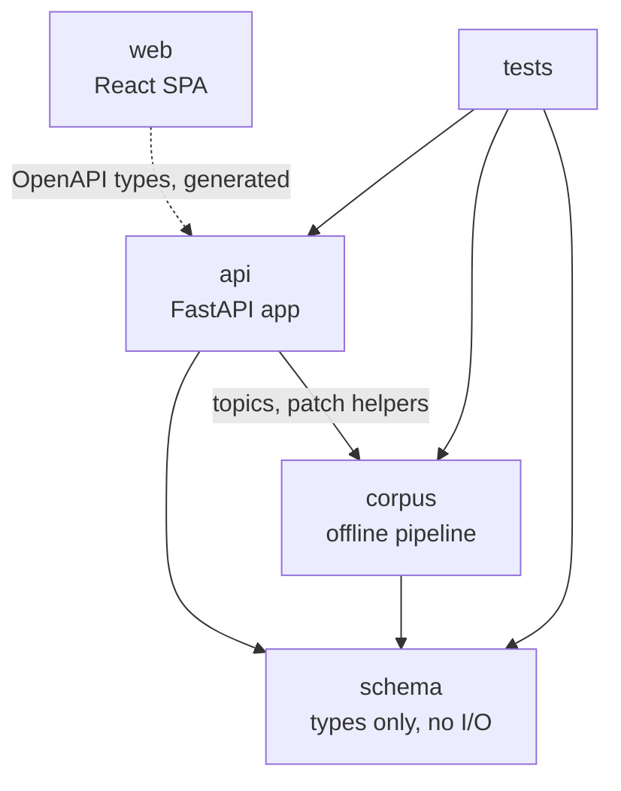
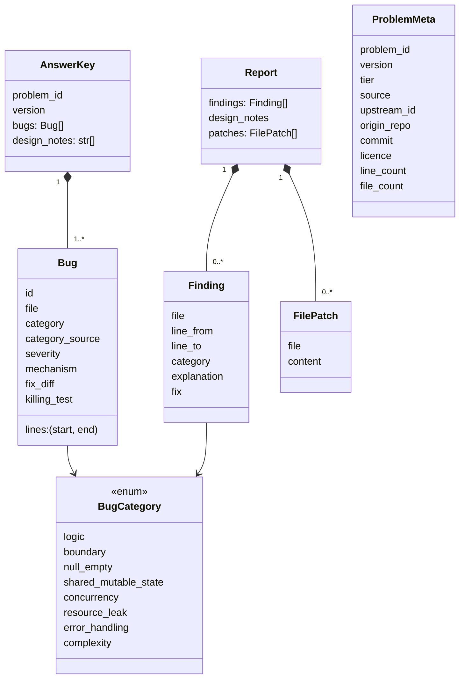
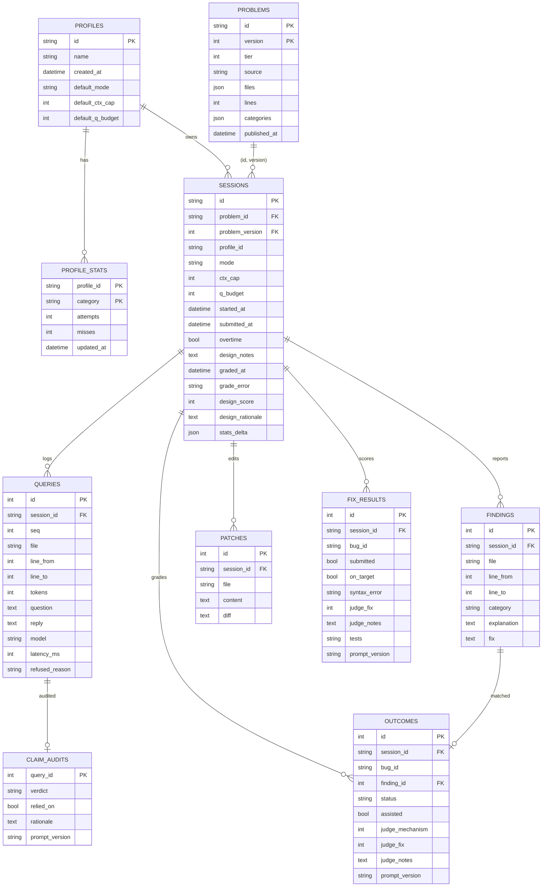
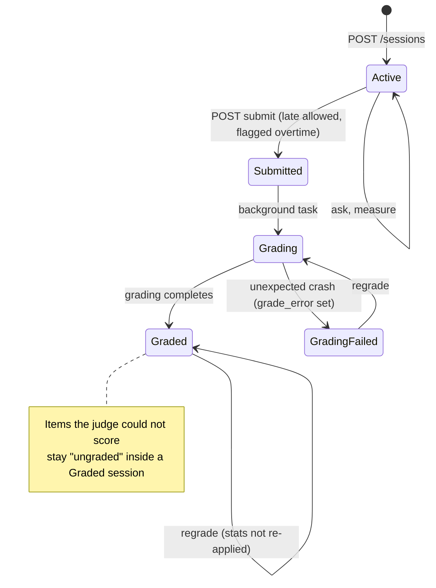
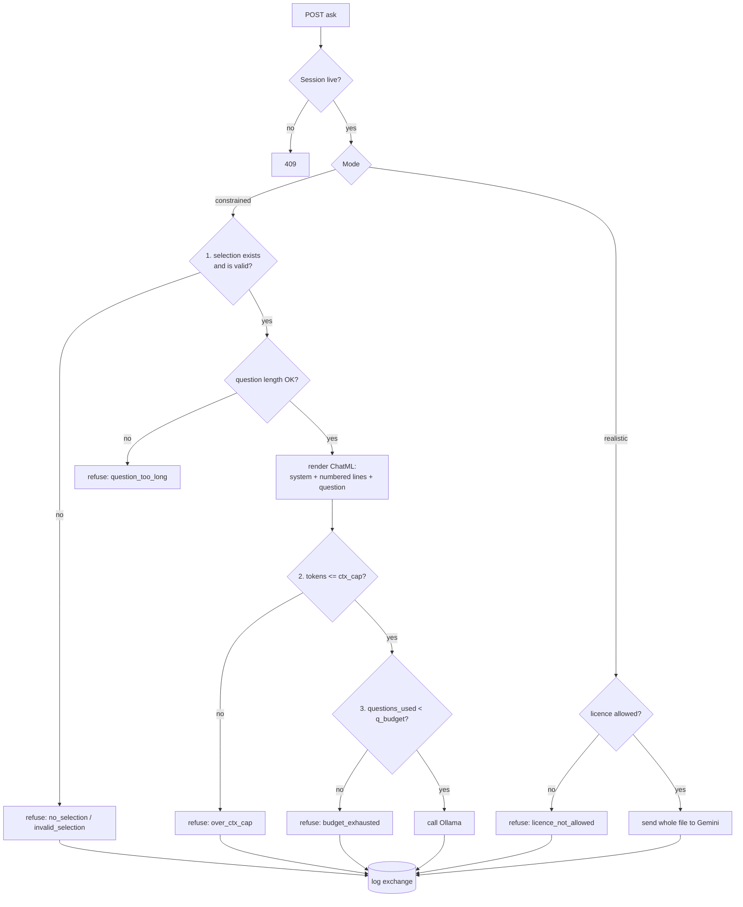
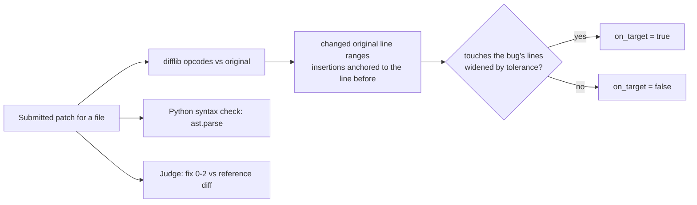
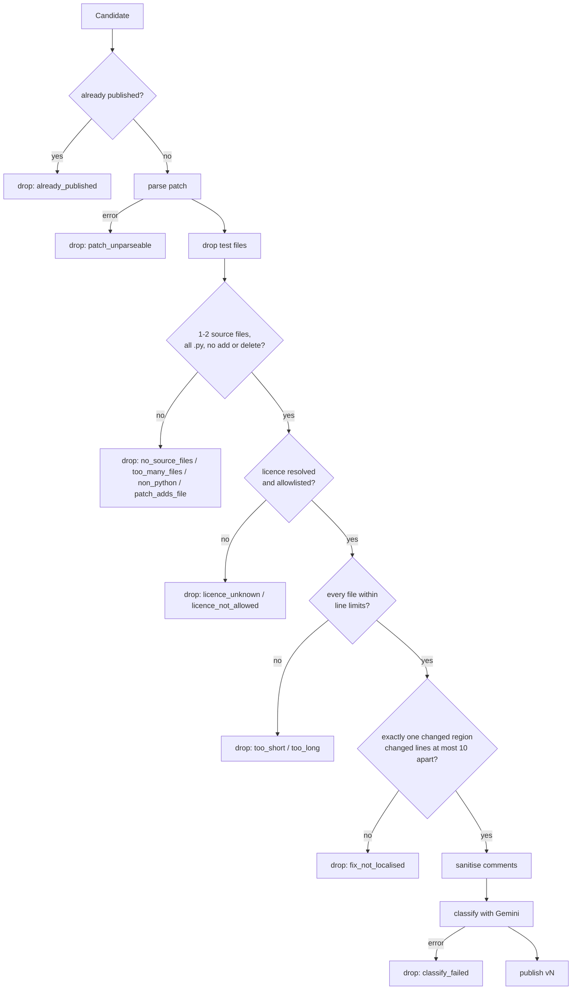
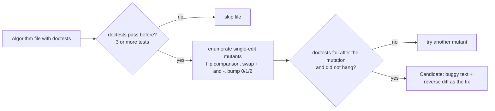
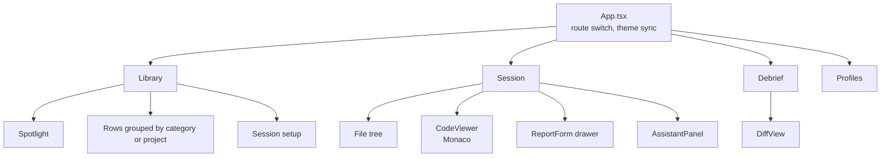

# Low-Level Design

The module-level design of Scholia: packages and dependencies, types, the data model, the API, the algorithms, the corpus pipeline and the frontend. Read the [High-Level Design](hld.md) first for the why; this document is the how. Names and file paths refer to the repository at the time of writing.

## Contents

1. [Packages and dependency rules](#1-packages-and-dependency-rules)
2. [Shared types (`schema/`)](#2-shared-types-schema)
3. [Data model](#3-data-model)
4. [API reference](#4-api-reference)
5. [Session lifecycle](#5-session-lifecycle)
6. [Assistant proxy](#6-assistant-proxy)
7. [Grader](#7-grader)
8. [Tracker and picker](#8-tracker-and-picker)
9. [Profiles](#9-profiles)
10. [Corpus pipeline](#10-corpus-pipeline)
11. [Frontend](#11-frontend)
12. [Errors, configuration, logging](#12-errors-configuration-logging)
13. [Testing](#13-testing)
14. [Extension points](#14-extension-points)

---

## 1. Packages and dependency rules



| Package | Rule |
|---|---|
| `schema` | Pydantic models and enums only. Imports nothing from the other packages. Strict-typed (mypy strict) |
| `corpus` | Runs offline from the CLI. May import `schema`. The API imports only its small, pure helpers (`topics`, `text`) |
| `api` | The server. `api/grader` is also strict-typed. Only `api/grader/run.py` and `api/debrief.py` read `answer.json` |
| `web` | Never imports Python. Its API types are generated from the OpenAPI document (`pnpm gen:api`), so the contract cannot drift silently |

```
api/
  main.py            app factory, lifespan, routers, error handlers
  config.py          Settings (pydantic-settings)
  db.py              SQLModel tables, engine, init_db and migration
  deps.py            lazy construction of proxy, grader, store
  problems.py        ProblemStore: read-only access to src/ and meta.json
  sessions.py        library, picker, clock, report intake, SessionView
  proxy.py           assistant proxy: all constraints
  profiles.py        profile routes and the X-Profile dependency
  debrief.py         the only answer-returning endpoint
  tracker.py         per-profile category stats, applied once
  tokens.py          exact token counting (HF tokenizer) and ChatML rendering
  jsonout.py         strict parsing of model JSON
  errors.py log.py openapi.py
  backends/          base (protocol) · ollama · gemini
  grader/            match · judge · audit · fix · run · agreement · prompts/
corpus/              sources/ · filters · patch · sanitise · classify · publish · build · repos · topics · text
schema/              taxonomy · answer · report · problem · session · grading
web/src/             pages/ · components/ · store/ · lib/ · api/ · router.tsx
```

## 2. Shared types (`schema/`)



- `Source` is `swebench | bugsinpy | planted`. `OutcomeStatus` is `found | partial | missed | extra | ungraded`. `ClaimVerdict` is `correct | wrong | unverifiable`. `AssistantMode` is `constrained | realistic`.
- `Report` validates at most one patch per file. File names use a `RelPath` type that rejects absolute paths and `..`.
- Changing `BugCategory` is a migration (stored values and stats), so it needs an explicit decision.

## 3. Data model



Notes:

- **Uniqueness.** `queries (session_id, seq)`, `patches (session_id, file)`, `fix_results (session_id, bug_id)`, `profile_stats (profile_id, category)`.
- **Problems.** The `problems` table is an *index*, rebuilt from the `problems/` folder on every API start. The folder is the source of truth.
- **`sessions.profile_id`** has no foreign key: it was added to existing databases with `ALTER TABLE ... DEFAULT 'default'`.
- **`category_stats`** is the pre-profile global table. It is kept only as the one-time migration source for the default profile.
- **Enums** are stored through SQLAlchemy's enum handling (by name); the migration copies them verbatim.
- **Foreign keys** are enforced (`PRAGMA foreign_keys=ON` on every connection).

### Migration

`init_db` runs `create_all`, then:

1. If `sessions.profile_id` is missing, add it (`NOT NULL DEFAULT 'default'`).
2. If `profiles` is empty (first start with profiles), insert the `default` profile and copy `category_stats` into `profile_stats`.

Both steps are idempotent. Step 2 runs only on an empty `profiles` table so that "reset stats" can never be undone by a restart.

## 4. API reference

Base path `/api`. JSON in and out. Errors use `{"error": {"code": string, "message": string}}`. Every route except health resolves the caller's profile from `X-Profile` (default: `default`; unknown: `404 profile_not_found`).

| Method and path | Purpose | Notes |
|---|---|---|
| `GET /health` | Liveness | No profile |
| `GET /profiles` · `POST /profiles` | List with counts · create | `409 profile_name_taken`, `409 too_many_profiles` (max 20) |
| `GET/PATCH/DELETE /profiles/{id}` | Read · rename and defaults · delete | `null` resets a default; `409 default_profile` on deleting `default` |
| `POST /profiles/{id}/reset-stats` | Forget weak-spot counts | Sessions kept |
| `GET /problems` | Library cards for this profile | Ordered: not attempted first, then picker weight. Carries `categories` (owner-approved exception) but never the upstream id, commit or key |
| `GET /stats` | Per-category attempts, misses, miss rate | This profile |
| `GET /settings` | Defaults and which modes are available | Profile defaults applied |
| `GET /sessions` · `POST /sessions` | History · start | Body `{problem_id?, source?, mode?, ctx_cap?, q_budget?}`; no `problem_id` means the weighted picker |
| `GET /sessions/{id}` | Files (src only), settings, time left, thread | `410 problem_files_missing` if the folder is gone |
| `POST /sessions/{id}/ask` | Ask the assistant | Refusals are `200` with `refused: true` |
| `POST /sessions/{id}/measure` | Token cost of a selection | No model call, no budget, not logged as an exchange |
| `POST /sessions/{id}/submit` | Freeze the report, run grading in the background | Report: `findings[]`, `design_notes`, `patches[]`; `422 invalid_patch`, `422 too_many_findings` |
| `GET /sessions/{id}/debrief` | Key against findings, scores, audit, diffs | `409 not_submitted`, `grading_pending`, `grading_failed` |
| `POST /sessions/{id}/regrade` | Grade again | `202` |

Refusal reasons (a closed enum): `no_selection`, `invalid_selection`, `question_too_long`, `over_ctx_cap`, `budget_exhausted`, `licence_not_allowed`, `backend_error`.

## 5. Session lifecycle



- **Clock.** `started_at` is server time. `seconds_left` is computed on read from the injected `now()`. Submitting after `session_minutes` is accepted and sets `overtime`.
- **Submit.** `freeze_report` validates finding ranges against each file's real length, validates each patch file exists, stores only patches that differ from the original (as a git-style unified diff), writes findings and patches, sets `submitted_at`, then schedules grading.
- **Debrief gating.** The debrief route checks `submitted_at` first (invariant 1).

## 6. Assistant proxy

`api/proxy.py` is the only path to a model during a session (invariant 2).



- **Check order (Constrained):** selection, then token cap, then budget. A refusal costs no budget but is logged with its reason.
- **What is sent.** Only the numbered selected lines and the question. No file path, no metadata, no history. The system prompt says the model is a code assistant seeing a fragment, and never mentions bugs or interviews.
- **Counting.** The cap check uses the real Qwen tokenizer over the fully rendered ChatML prompt, including the question. `measure` returns the same number for the UI's context bar.
- **Budget** is `count(queries where refused_reason is null)` for the session, so refusals and backend errors are free.
- **Failures.** A backend error is logged as a `backend_error` refusal and costs nothing. Backends retry on 429 and 5xx with exponential backoff.
- **Gemini reasoning.** Models that think before answering count hidden tokens against `max_output_tokens`, so the Gemini backend adds `GEMINI_THINKING_TOKENS` to every limit; otherwise long prompts return empty text.

## 7. Grader

`api/grader/run.py` orchestrates one pass and is the only code (with the debrief route) that opens `answer.json` for a session. It refuses sessions without `submitted_at`.

### 7.1 Matching (`match.py`)

Pure functions, no I/O.

```
match(bugs, findings, tolerance):
    candidates = [(bug, finding, overlap) for bug, finding in bugs x findings
                  if same_file and overlap(bug widened by tolerance, finding) > 0]
    sort candidates by overlap desc (stable)
    assign greedily, one-to-one
    unmatched bugs -> missed; unmatched findings -> extra
```

- **Overlap** is the number of shared lines between inclusive ranges, after widening the bug by `MATCH_TOLERANCE_LINES` (default 3) on both sides.
- **Complexity** is O(B x F log(B x F)); both are tiny (one bug per Tier 0 problem, at most 50 findings).
- **File equality** compares normalised relative paths.
- The LLM is never consulted here (invariant 9).

### 7.2 Judging (`judge.py`, `prompts/`)

| Prompt | Input | Output (strict JSON) |
|---|---|---|
| `judge-finding-v2` | Key bug and mechanism, the matched finding, the code | `mechanism` 0-2, `fix` 0-2, notes |
| `judge-patch-v1` | Key bug, reference diff, the candidate's diff | `fix` 0-2, notes |
| `judge-design-v1` | Reference design notes, the candidate's notes | `score` 0-3 |
| `audit-v1` | Key bugs, the lines shown, the question, the reply | `verdict`, rationale |

- `Judge.ask` parses with `parse_model_json` (strips a fence, validates against a Pydantic model). On a parse failure it retries once, then returns `None`, and the item becomes `ungraded`. A score is never guessed.
- **Status.** A matched finding is `found` if mechanism is 2, else `partial`. Never `missed`.
- **No key, no model, or non-allowlisted licence:** the judge is `None`; matched bugs are `ungraded`.
- Every outcome stores the prompt version, so a rubric change is traceable.

### 7.3 Audit (`audit.py`)

For each answered query the judge labels the reply `correct`, `wrong` or `unverifiable` against the key. `relied_on` is true when a `wrong` claim about lines X is followed by the user missing a key bug that overlaps X, or matching it with a mechanism score below 2. Replies the judge could not label get no `claim_audits` row and show as "not audited". **assisted** on an outcome means any answered query's range overlapped the bug.

### 7.4 Code fixes (`fix.py`)



A bug whose lines were fixed is counted as *located*, not missed, in the category stats even if no finding was flagged. Running tests on the fix is not built.

### 7.5 Orchestration order

1. Load session, findings, queries, key. 2. Match. 3. Judge matched pairs (and write `OutcomeRow`s). 4. Score design notes (skipped if empty or no reference). 5. Audit replies. 6. Score fixes. 7. Apply the tracker once. 8. Set `graded_at`. A regrade deletes outcomes, audits and fix results for the session and recomputes, but the tracker is idempotent.

## 8. Tracker and picker

**Tracker (`tracker.py`).** After grading, for each key bug: `attempts += 1` in its category, and `misses += 1` if it is `missed` (and not located by a fix). The before/after numbers are stored in `sessions.stats_delta`; a non-null value is the "already applied" marker. Stats are per profile.

**Picker (`sessions.py`).**

```
weight(problem) = 0.1 + sum(miss_rate[c] for c in problem.categories)
pool            = unattempted problems (this profile), or all once none remain
choice          = weighted random over pool
```

`miss_rate[c] = misses / attempts` (categories with no attempts contribute 0). The 0.1 exploration floor keeps unseen categories reachable. The Library ordering uses the same weights but never sends them to the client.

## 9. Profiles

- A profile owns sessions (`sessions.profile_id`), stats (`profile_stats`) and optional defaults. Problems and keys are shared.
- `current_profile` reads `X-Profile`. All list, stats, settings and picker queries filter by it. Session ids stay global, so a link to a debrief works from any profile.
- Create enforces unique names (case-insensitive) and a maximum of 20. Delete cascades through `claim_audits`, `queries`, `findings`, `outcomes`, `patches`, `fix_results`, `sessions`, `profile_stats`.
- **This is not authentication.** The header is trusted as sent.

## 10. Corpus pipeline



Key behaviours:

- **Hunk location.** Patch hunk headers can be off from `base_commit`; changed lines are located by hunk *content*, not header numbers. Lines are split on `\n` only (not form feeds), to agree with git and the editor.
- **One fix, one bug.** Import-only change groups are ignored. The remainder must form one region (points within 10 lines), in one file. This is why every Tier 0 problem has exactly one key bug.
- **Sanitise.** Removes comments that mention the fix, TODO/FIXME/XXX on the bug's lines, and issue numbers; replaces a removed comment line with an empty line so line numbers stay stable; never alters code semantics. The result is checked to still parse.
- **Selection.** `--limit N` counts *published* problems. Candidates are scanned round-robin across repos (one per repo in turn), so a small build spans many projects. Topics (`LIBRARY_TOPICS`) are applied before any work.
- **Output.** `problems/P-NNNN/vN/{src/, answer.json, meta.json, tests/}`; the index table is registered afterwards. Every run writes `data/logs/build-<source>-<stamp>.json` accounting for each candidate.

### Planted bugs (`sources/planted.py`)



Mutants are generated from the AST (positions, not regex), must still parse, and one is chosen per file with a seeded RNG, so the same seed yields the same problems. The answer key is the reverse of the mutation; no model writes the bug.

## 11. Frontend



| Concern | Choice |
|---|---|
| Routing | A 40-line History API router (`router.tsx`): four pages need no library |
| Server state | TanStack Query. Keys are plain strings; switching profile clears the cache |
| Client state | Zustand with `persist`: the report **draft** (findings, notes, edited files) per session; the active **profile**; the **theme** |
| API client | `web/src/api/client.ts` over `fetch`, typed from `schema.d.ts` (generated from OpenAPI). Adds `X-Profile`; on `profile_not_found` it resets to the default profile |
| Editor | Monaco, bundled locally (no CDN), trimmed to Python. Read mode is read-only; **Fix** mode is writable and reports content changes. Click two line numbers to select a range |
| Fix mode | Edited files live in the draft and are submitted as `patches`. Re-opening a file keeps its edit; resetting a file removes it |
| Timer | Display only, ticking from the last server sync (`seconds_left`) |
| Theming | RGB-channel CSS variables; Tailwind colour names map to them; `data-theme` set before first paint; Monaco has matching themes |
| Layout | Rules and rows instead of cards; compact controls; the report draft is a collapsible drawer so the code keeps the space |
| Accessibility | Real buttons and labels, focus rings, `aria-*` on toggles and menus, reduced-motion support |

## 12. Errors, configuration, logging

- **Errors.** `ApiError(status, code, message)` plus handlers for HTTP and validation errors, all rendered as the envelope above. Domain failures use specific codes (`invalid_patch`, `grading_pending`, ...).
- **Configuration.** `Settings` (pydantic-settings) reads the environment and `.env`. See [operations.md](../guides/operations.md#configuration-reference). `GEMINI_MODEL` is the fallback for `JUDGE_MODEL` and `REALISTIC_MODEL`; the Gemini key is a `SecretStr`.
- **Logging.** A JSON formatter; structured `extra` fields (`upstream_id`, `reason`, `id`). Assistant exchanges are persisted in `queries`, not only logged.

## 13. Testing

| Layer | What is tested |
|---|---|
| Schema | Round trips and validation (paths, ranges, one patch per file) |
| Matcher | Table-driven cases: overlap, tolerance, one-to-one assignment |
| Grader | Hand-graded fixtures in `tests/fixtures/graded/` with expected outcomes; judge faked |
| Proxy | Each refusal path, check order, cost accounting, prompt content (no bug mention) |
| Invariants | **Answer leak** test over every live-session route; licence gate; immutability; server clock; config-only model names |
| Corpus | Patch parsing and location, sanitiser, filters, classifier JSON, publish, topics, planted mutations |
| API | Through `httpx.ASGITransport` with fake backends; profiles, fixes, debrief |
| Live (opt-in) | `pytest -m live` calls real Ollama, Gemini and the tokenizer |

CI runs ruff, mypy (strict on `schema/` and `api/grader/`), pytest, and the web typecheck, lint and build.

## 14. Extension points

| To add | Touch |
|---|---|
| A bug source | A class yielding `Candidate`s in `corpus/sources/`, register it in `source_for`, add its repos to `corpus/topics.py` |
| A topic | `Topic` enum, `REPO_TOPICS`, and the default in `Settings.library_topics` |
| An assistant backend | Implement `ChatBackend.chat`, construct it in `deps.py` |
| A rubric | Add or edit a prompt in `api/grader/prompts/` and bump its version header |
| A bug category | `BugCategory`, the classifier prompt, the web labels, and a stats migration (ask first) |
| A mutation operator | `mutations()` in `corpus/sources/planted.py` plus a test |
| A page | A route in `router.tsx`, a case in `App.tsx`, a top bar with `ThemeToggle` |
